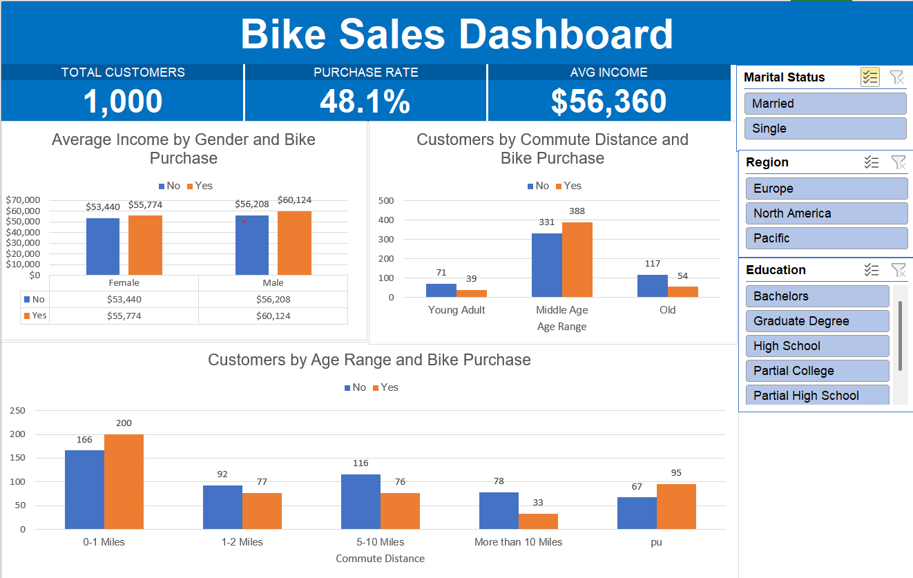

# Bike Sales Dashboard (Excel)

Which customer traits are linked to buying a bike? A self-study Excel project: data cleaning, PivotTables, charts and an interactive dashboard with slicers and KPI cards.

> Built by following [Alex the Analyst's tutorial](https://www.youtube.com/watch?v=opJgMj1IUrc). The dataset and the base steps come from that tutorial; the items under **My additions** are my own work.

## Business question

What distinguishes customers who bought a bike from those who did not (income, commute distance, age, region, marital status, education, number of cars)?

## Dataset

- 1,026 raw rows, 13 columns (ID, Marital Status, Gender, Income, Children, Education, Occupation, Home Owner, Cars, Commute Distance, Region, Age, Purchased Bike).
- 26 duplicate rows removed, leaving **1,000 customers**.
- File: `Excel Project Dataset.xlsx`

| Sheet | Content |
|---|---|
| `bike_buyers` | Raw data |
| `Working_Sheet` | Cleaned data + helper columns (Age Range, Purchased Flag, Income Band) |
| `Pivot_Table` | The 3 tutorial PivotTables and charts, plus the KPI PivotTable |
| `Findings` | Purchase rate by customer attribute (7 PivotTables) |
| `Dashboard` | KPI cards, 3 charts, 3 slicers |
| `Process_Notes` | Log of every step, with questions and answers |

## Process

| Step | What I did |
|---|---|
| Remove duplicates | Removed 26 duplicate rows |
| Decode values | Find & Replace: M/S to Married/Single, M/F to Male/Female |
| Age Range | `IFS` formula: under 31 = Young Adult, 31-55 = Middle Age, over 55 = Old |
| Helper columns | `Purchased Flag` (1 if bought, so the average equals the purchase rate) and `Income Band` (up to 40K, 40-60K, 60-80K, over 80K) |
| PivotTables | Average income by gender, commute distance and age range by purchase |
| Dashboard | 3 charts, 3 slicers (Marital Status, Region, Education), 3 KPI cards that react to the slicers |

## Key findings

- Overall purchase rate is **48.1%** (481 of 1,000 customers).
- Income is a weak signal: buyers earn about **6% more** on average ($57,963 vs $54,875), and the purchase rate stays between 47% and 53% across income bands.
- Customers with **no car** buy most often (61.1%), against 36.3% for customers with 2 cars.
- **Middle-aged** customers buy at 54.0%, against 31.6% for the oldest group.
- **Single** customers buy more than married ones (54.1% vs 42.9%).
- Customers living **more than 10 miles** from work buy least (29.7%).
- Region matters: Pacific 58.9%, North America 43.3%.

These are associations in a small sample (some groups have fewer than 100 customers), not proof of cause.

## My additions

- Helper columns and a `Findings` sheet with purchase-rate PivotTables, going beyond the three tutorial charts.
- Dashboard fixes: slicers reset to show all customers, axes start at zero, category data in column charts, cleaner titles, KPI cards.

## How to use

Open `Excel Project Dataset.xlsx`, go to the `Dashboard` sheet, and click the slicers to filter by marital status, region or education. The KPI cards update with the filters.